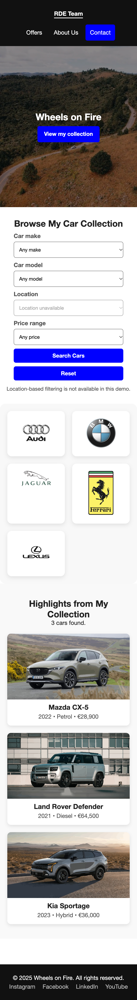

<h1 align="center">Wheels on Fire</h1>
<p align="center">A car collection and community website by the RDE Team.</p>

<p align="center">
  
  
  
</p>

## Overview

Wheels on Fire is a responsive, multi-page website showcasing John O’Reilly’s car collection, his story, and an archived community event. Built with HTML, CSS, and vanilla JavaScript, it includes interactive collection filters and a browser-only contact-form demo.

## Key features

- **Browse and filter:** Explore three vehicle cards with photographs and specifications; filter by make, model, and price, with result counts and reset controls.
- **Explore the story:** A muted, looping video introduces the collection, while the About page presents the collector’s background.
- **View the event archive:** Read about the Dublin car meet on 26 November 2025, clearly marked as a past event with a closed offer.
- **Try contact validation:** Required-field, whitespace, and email checks provide field-specific errors and a validation status message.
- **Navigate across devices:** Shared navigation, responsive grids, keyboard focus indicators, and consistent footers support the four main pages.

## Project Preview

### Desktop View


### Mobile View



| Page | What to explore | Source |
| --- | --- | --- |
| Home | Video introduction, brand gallery, and car filters | [index.html](index.html) |
| About | Collector biography and short-page footer layout | [about.html](pages/about.html) |
| Contact | Form fields and validation feedback | [contact.html](pages/contact.html) |
| Offers | Archived event details and closed offer | [offers.html](pages/offers.html) |

*Planned screenshots: desktop collection, mobile filters, About footer, contact validation, and the event archive. No placeholder image files are linked.*

## Tech stack

| Technology | Purpose |
| --- | --- |
| HTML5 | Page structure, semantic landmarks, forms, and embedded video |
| CSS | Shared styling, Grid and Flexbox layouts, media queries, and focus states |
| Vanilla JavaScript | DOM-based car filtering and client-side form validation |
| Local media | JPEG photographs, PNG/SVG logos, an SVG favicon, and MP4 video |
| Git | Version history and team collaboration |

The site has no framework, package dependencies, build step, backend, or database. Python is optional tooling for the local server described below; it is not part of the website runtime.

## Project structure

```text
WebDev_Project_RDE/
├── index.html           # Home page and collection
├── events_offers.html   # Legacy redirect to the Offers archive
├── pages/
│   ├── about.html
│   ├── contact.html
│   └── offers.html
├── css/style.css        # Shared and responsive styles
├── script/main.js       # Filters and contact validation
├── media/               # Photos, logos, favicon, and hero video
└── README.md
```

Four supporting Word documents also sit at the repository root; they are omitted from this website-focused tree. Some SVG assets in `media/` are retained but unused by the current pages.

## Getting started

Use a modern web browser. To serve the site locally with the command below, install Python 3. Git is needed only if you clone the repository rather than download it.

1. Clone your team's repository or fork, then open its `WebDev_Project_RDE` directory. If you already have a checkout, use that directory.
2. From the project root, start a local static server:

   ```sh
   python3 -m http.server 8000 --bind 127.0.0.1
   ```

3. Open [the local home page](http://127.0.0.1:8000/index.html) in your browser.
4. Stop the server with `Ctrl+C` when finished.

No installation command, environment variables, credentials, or build process is required. Keep the folder structure intact so relative asset and navigation paths resolve correctly. You can also use another static server rooted at the project directory.

To explore the implementation, start with [index.html](index.html), [the shared stylesheet](css/style.css), and [the JavaScript](script/main.js).

## Responsive design and accessibility

- **Responsive layouts:** Media queries adapt navigation, filters, grids, typography, and contact-form dimensions for narrow, tablet, and desktop viewports.
- **Footer placement:** A column Flexbox page layout uses `100vh` as a fallback for `100dvh`, with a flexible main element. Footers stay in normal document flow rather than overlaying content.
- **Keyboard navigation:** Each main page has a visible-on-focus skip link, a focusable main landmark, and explicit focus indicators. Scroll spacing helps keep focused content clear of the sticky header, which becomes static on narrow or short viewports.
- **Page orientation:** Descriptive titles, labelled navigation landmarks, and `aria-current="page"` identify the current page.
- **Form feedback:** Labels are associated with controls; error descriptions, `aria-invalid`, and polite status announcements communicate validation results. Invalid submissions focus the first field requiring attention.
- **Control contrast:** Select, input, and textarea borders use `#767676`, providing approximately **4.54:1** contrast against white.
- **Media handling:** Collection and logo images have alternative text, explicit dimensions, and native lazy loading.
- **Reduced motion:** Decorative transitions and transforms are reduced, and search results scroll immediately when reduced motion is requested. The hero video is an exception, noted below.
- **JavaScript fallback:** The full collection remains visible without JavaScript. Filtering and the contact check button remain disabled, with explanatory messages.

These are implemented improvements, not a claim of complete accessibility conformance.

## Testing and QA

Development regression checks covered the Home, About, Contact, and Offers pages in desktop Chrome at **375px, 768px, and 1440px** viewport widths. Checks included responsive layout, footer placement, filtering, form validation, keyboard focus, asset loading, and the legacy Offers redirect. These viewport checks do not establish support across all browsers or physical devices.

The repository does not include an automated test runner or committed QA scripts. To repeat the main checks, serve the site locally and use browser developer tools to test each width:

| Area | Checks and expected results |
| --- | --- |
| Layout | No horizontal overflow or clipped content. The footer ends at the document bottom, reaches the viewport bottom on short pages, and does not overlap content. |
| Navigation | Main navigation, Back to Home, the collection anchor, and the legacy Offers redirect reach their intended destinations. |
| Filters | Kia → Sportage returns one car; a price range of €0–€20,000 returns no cars; Reset restores all three cards. Changing make clears an incompatible model selection. |
| Contact form | Empty and whitespace-only fields show errors. An invalid email is rejected. Valid details produce a message explicitly stating that nothing was sent or saved. |
| Keyboard | Tab reveals the skip link and visible focus indicators. Enter activates the skip link; focused controls remain visible. |
| Motion and fallback | Reduced-motion settings remove decorative transitions and smooth search scrolling. With JavaScript disabled, the full collection and explanatory messages remain available. |
| Assets and console | Images, styles, scripts, favicon, and video load without missing-resource errors or JavaScript exceptions. |

Before submitting changes, check for whitespace errors:

```sh
git diff --check
```

## Team collaboration and contributions

The website identifies its creators as the **RDE Team**. The Git history records contributions from multiple authors and provides attribution for individual changes; this README does not assign unverified roles or responsibilities.

When contributing, keep changes focused, reuse the shared stylesheet and script where appropriate, and check all four pages at the documented viewport widths. Include the purpose of the change and relevant validation results in the team's review process.

To inspect contributions locally:

```sh
git shortlog -sn HEAD
git log --oneline
```

## Known limitations

- **The contact form is a demo.** It validates details in the browser only. There is no delivery service or application storage, and no message is sent or saved by the site.
- **The collection is static.** Filtering uses the three cards and their `data-*` attributes in `index.html`; there is no inventory API or database.
- **Location filtering is unavailable.** The location control is intentionally disabled and accompanied by an explanation.
- **Events and offers are archived.** Ticket purchases and calendar downloads are unavailable for the past event.
- **Social names are placeholders.** Footer social items are text, not working profile links.
- **The hero video autoplays and loops without a pause control.** It continues playing under reduced-motion preferences.
- **Browser coverage is limited.** The documented Chrome checks are not a full cross-browser, assistive-technology, or accessibility audit.
